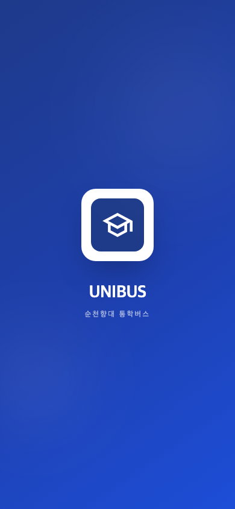
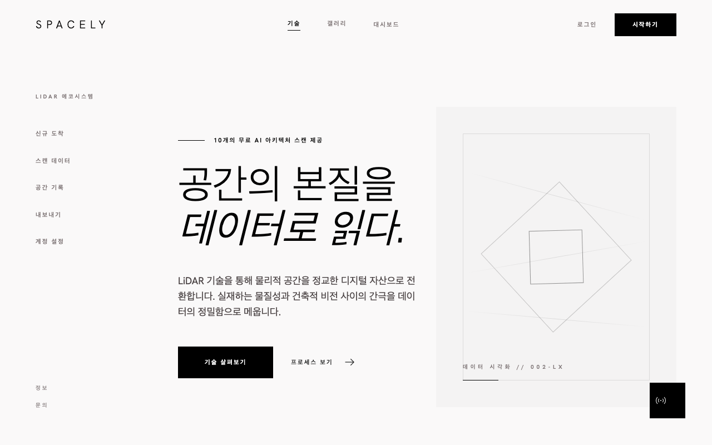

# Jaewon Kwon

Frontend-focused full-stack developer building interactive learning tools, campus services, and spatial web experiences. I work mainly with React and TypeScript, connecting interfaces to real-time data, Python backends, and native iOS scanning.

## Projects

### [UNIBUS SCH](https://github.com/Unibus-sch/unibus-sch) — 순천향대학교 셔틀버스 앱

A mobile web app for campus shuttles and commuter buses, with separate workflows for students, drivers, and administrators.

- **Passenger experience:** Naver Maps bus tracking, stop-by-stop arrival estimates, commuter route schedules and fares, PAYCO booking links, and the Sinchang train timetable.
- **Driver workflow:** Start and end trips, collect GPS coordinates and heading, and send location updates every five seconds.
- **Operations:** Manage buses, routes, notices, users, and support requests; monitor active trips and the latest GPS reception in the admin dashboard.
- **Recent improvements:** Smoother route-following animation for campus and commuter buses, multiple-bus map views, and admin status aligned with the live map.
- **App features:** Kakao login, Korean/English interfaces, PWA installation, and Web Push notifications for notices.

**Stack:** React · TypeScript · Vite · Tailwind CSS · Framer Motion · Naver Maps · Supabase PostgreSQL / Realtime · Deno / Hono · Vercel

---

### Spacely — LiDAR 스캔·3D 공간 편집

Scan an indoor space with an iPhone and explore or edit the room in a browser.

- **Scan to web:** Apple RoomPlan captures walls and objects; converted room data is uploaded to Supabase and rendered in the web viewer.
- **Spatial viewer:** Switch between interactive 3D and a 2D floor plan, with walls, doors, windows, object labels, and dimensions.
- **Room editing:** Add or delete objects, drag and rotate furniture, edit object properties, undo position changes, and persist edits to Supabase.
- **Expanded workflow:** Import OBJ meshes and use Gemini-assisted scene analysis to generate structured room data.
- **Presentation:** A monochrome landing page and viewer, with lighting and floor-material controls.

**Stack:** Swift · Apple RoomPlan · React · TypeScript · Three.js · React Three Fiber / Drei · Zustand · GSAP · Supabase · Gemini

---

### 먹깨비 — 소셜 푸드 다이어리

Turn food photos into stickers and collect them on a shared physics board with friends.

- **Photo to sticker:** Remove.bg removes the background and Gemini generates a short food description.
- **Physics interactions:** Gravity, bounce, and sticker collisions, with tilt and shake input and frame-rate-independent animation.
- **Shared diary:** Invite-code groups, a shared board and activity feed, comments, and reactions.
- **Food history:** Recording streaks, category statistics, weekly activity charts, and a Google Maps view of photo locations.
- **Mobile experience:** Kakao OAuth login, PWA installation, and layouts adapted to iOS safe areas.

**Stack:** React · TypeScript · Vite · Tailwind CSS · Node.js / Express · Firebase Firestore · Gemini · Remove.bg · Google Maps · Railway

---

### [Interactive Learning Lab](https://github.com/ddingddong9/interact_hp) — 자료구조·코드 실행 시각화

An interactive learning site for exploring data structures, system behavior, and how code executes.

- Step through Hash Tables, Linked Lists, Skip Lists, and Sorted Sets with visual simulations.
- Compare race conditions and atomic operations, explore Lua script flows, and simulate rate- and concurrency-limited admission.
- Follow Java, C, and Python execution with explanations of variable and memory changes.

**Stack:** React · TypeScript · Vite · SVG/CSS

---

### [Flask Board](https://github.com/ddingddong9/board-vagrant) — 게시판·텍스트 분류

Flask board applications used as source for automatic deployment into a Vagrant VM.

- Board and category-classification apps backed by MySQL through PyMySQL.
- Text filtering and classification with TF-IDF and Multinomial Naive Bayes.
- Environment-based database configuration and training scripts that generate models during installation.

**Stack:** Python · Flask · MySQL · scikit-learn

---

## Skills

**Languages**  
   

**Frontend**  
    

**Backend**  
   

**Database & Services**  
  

**Data & ML** 

**Tools & Deploy**  
  

---

> Always building something.
