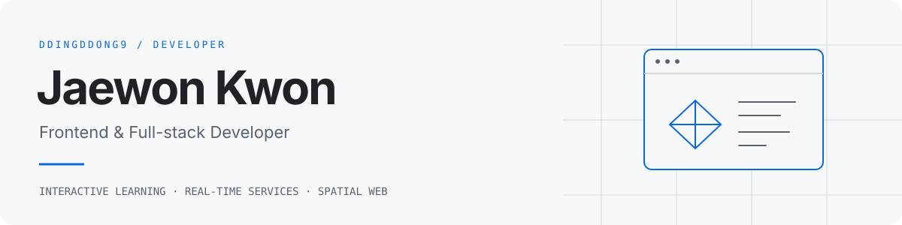

<picture>
  <source media="(prefers-color-scheme: dark)" srcset="assets/header-dark.svg">
  <source media="(prefers-color-scheme: light)" srcset="assets/header-light.svg">
  
</picture>

  <a href="#about">About</a> &nbsp;·&nbsp;
  <a href="#projects">Projects</a> &nbsp;·&nbsp;
  <a href="#tech-stack">Tech Stack</a>

  
  
  
  

## About

안녕하세요, **권재원**입니다. React와 TypeScript를 중심으로 프론트엔드부터 API·데이터베이스까지 연결하는 개발을 합니다.

- **인터랙션** — 자료구조와 코드 실행 과정을 직접 조작하며 이해하는 학습 도구를 만듭니다.
- **실시간 서비스** — 버스 위치와 운영 상태, 함께 쓰는 음식 기록을 화면에 연결합니다.
- **공간 시각화** — iOS의 LiDAR 스캔을 웹의 3D 뷰어와 공간 편집 경험으로 확장합니다.

## Projects

### 01 / UNIBUS SCH

<table>
<tr>
<td width="230" align="center">

</td>
<td valign="top">
<h3>순천향대학교 셔틀버스 앱</h3>

학생의 버스 조회부터 기사의 GPS 전송, 관리자의 운영 관리까지 연결하는 모바일 웹 앱입니다.

<ul>
<li>학내순환·통학버스 위치, 정류장별 도착 예상 시간과 노선 조회</li>
<li>기사의 운행 시작·종료와 GPS 전송, 관리자 운영 대시보드</li>
<li>카카오 로그인, 한국어·영어, 공지 푸시 알림과 PWA</li>
</ul>

<b>React · TypeScript · Naver Maps · Supabase · Deno / Hono</b>

<a href="https://github.com/Unibus-sch/unibus-sch">Repository ↗</a>

</td>
</tr>
</table>

구현 내용 더 보기

- 통학 노선의 시간표·요금·PAYCO 예약 연결과 신창역 열차 시간표를 제공합니다.
- 기사 화면에서 GPS 좌표와 방위각을 수집하고, 5초 간격으로 위치를 전송합니다.
- 관리자 화면에서 버스·노선·공지·사용자·문의를 관리하고 운행 상태와 마지막 GPS 수신 시각을 확인합니다.
- 최근 학내순환·통학버스의 경로 이동 애니메이션, 다중 버스 표시, 지도와 관리자 운영 상태 연동을 개선했습니다.
- React, Vite, Tailwind CSS, Framer Motion을 사용하며 Supabase PostgreSQL·Realtime과 Edge Functions를 연결합니다.

### 02 / Spacely

**LiDAR 스캔에서 3D 공간 편집까지.** iPhone으로 스캔한 방을 웹에서 확인하고 가구 배치를 수정합니다.

- Apple RoomPlan 스캔 → Supabase 저장 → 웹의 **3D·2D 평면 뷰**로 연결
- 객체 추가·삭제, 드래그·회전, 속성 편집과 위치 변경 되돌리기
- OBJ 메시 가져오기와 Gemini를 활용한 구조화된 공간 데이터 생성

**Swift · RoomPlan · React · Three.js · React Three Fiber / Drei · Zustand · Supabase**

구현 내용 더 보기

- 벽·문·창문과 객체를 렌더링하고 치수·라벨을 표시합니다.
- 객체 위치·회전·속성 변경을 Supabase에 저장합니다.
- OBJ 메시 화면을 Gemini로 분석해 공간 데이터로 변환하고 저장하는 흐름을 구현했습니다.
- 조명과 바닥 재질을 바꿀 수 있으며, 모노크롬 랜딩 페이지와 뷰어를 구성했습니다.
- TypeScript, Vite, GSAP을 함께 사용합니다.

### 03 / 먹깨비

**친구들과 함께 쓰는 소셜 푸드 다이어리.** 음식 사진을 배경 없는 스티커로 만들고, 물리 효과가 있는 보드에 함께 기록합니다.

- Remove.bg 배경 제거와 Gemini 음식 한 줄 평
- 중력·충돌·탄성, 기울이기·흔들기에 반응하는 스티커
- 초대 코드 그룹, 댓글·반응, 기록 통계와 위치 지도

**React · TypeScript · Express · Firestore · Gemini · Google Maps**

구현 내용 더 보기

- 프레임 간 경과 시간을 기준으로 물리를 계산해 디스플레이 주사율에 따른 동작 차이를 줄였습니다.
- 그룹 보드와 활동 피드, 연속 기록 일수·음식 카테고리·주간 활동 통계를 제공합니다.
- 음식 사진의 촬영 위치를 저장하고 Google Maps에서 확인합니다.
- 카카오 OAuth, PWA 설치와 iOS 안전 영역을 고려한 화면을 구현했습니다.
- Vite, Tailwind CSS, Node.js, Firebase Admin SDK를 사용하고 Railway에 배포합니다.

### More things I build

| 프로젝트 | 구현 내용 | 기술 |
| :--- | :--- | :--- |
| [Interactive Learning Lab](https://ddingddong9.store) | 자료구조·경쟁 상태·원자적 연산 시뮬레이터, Java·C·Python 실행 시각화 | React · TypeScript · SVG |
| [Flask Board](https://github.com/ddingddong9/board-vagrant) | Vagrant VM 배포용 게시판·텍스트 분류 앱, TF-IDF와 Naive Bayes 모델 학습 | Python · Flask · MySQL · scikit-learn |

## Tech Stack

| 영역 | 사용 기술 |
| :--- | :--- |
| **Languages** | TypeScript · JavaScript · Python · Swift |
| **Frontend** | React · Vite · Tailwind CSS · Framer Motion |
| **3D & Native** | Three.js · React Three Fiber / Drei · GSAP · Apple RoomPlan |
| **Backend** | Node.js · Express · Deno · Hono · Flask |
| **Data** | PostgreSQL · MySQL · Supabase · Firebase Firestore |
| **AI & ML** | Gemini API · Remove.bg API · scikit-learn |
| **Tools & Deploy** | Git · Vercel · Railway |

---

Layout inspired by <a href="https://github.com/abhisheknaiidu/awesome-github-profile-readme">Awesome GitHub Profile README</a>.
